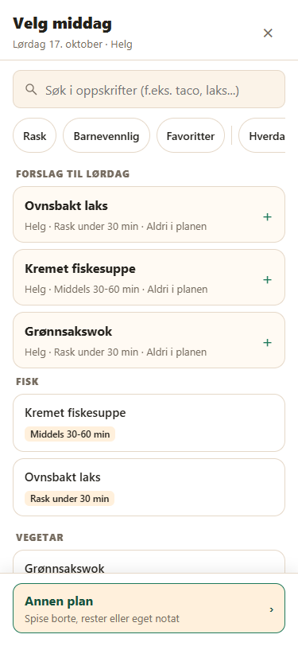
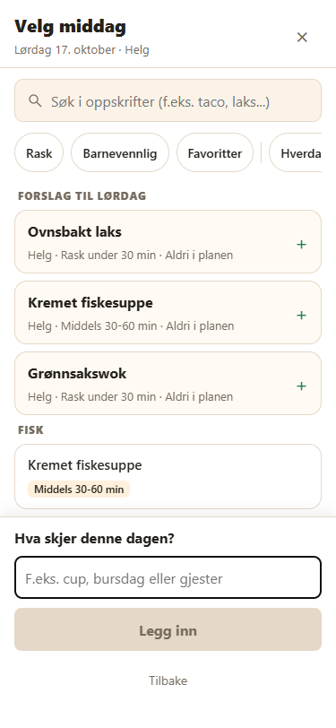

# Leveranse v120 – Annen plan med eget notat

Dato: 14. oktober 2026. Utgangspunkt: v119.

## Resultat

Middagsvelgerens faste bunnfelt har nå en tydelig, beige knapp med grønn kant: **Annen plan**, med undertittelen «Spise borte, rester eller eget notat». Åpent panel viser vanlige planvalg, deretter **Eget notat** med appens felles blyantikon, og Avbryt.

Eget notat åpner et felt med dagens notat, maks 60 tegn og 16 px skrift. Feltet får fokus fra klikket. Tom eller bare blank tekst gir deaktivert, grå Legg inn. Enter og Legg inn bruker samme handling: lagrer teksten og `_note`, fjerner eventuell middag og lukker velgeren. En eventuell forelder i dagsarket kommer tilbake. Tilbake fra feltet viser planvalgene igjen; utkastet ligger bare i minnet fram til Legg inn.

Ukeraden viser notatet som tittel, med Eget notat som reserve når teksten er tom. Notatet gjentas ikke under tittelen. Dagsarket tilbyr Eget notat separat og det vanlige notatfeltet endrer tittelen. Når en middag velges senere, settes planen til home og notatet beholdes som underlinje.

## Endrede og nye filer

| Mappe | Fil | Status og endring |
|---|---|---|
| Rot | app.js | Annen plan/notatflyt, runtime-utkast, historikknivå, felt/Enter, reservert planvalg, visning og gjennomgang av alle planavhengige handlinger. V120/120. |
| Rot | styles.css | Footer-skygge, tolinjeknapp, planikoner og notatfelt/knapper, inkludert deaktivert stil. |
| Rot | index.html | Alle versjonsparametre til 120. |
| Rot | service-worker.js | Cache v120 og ny renderer i begge asset-listene; cachestrategien beholdes. |
| Rot | AGENTS.md | Regler for reservert planvalg, minneutkast, historikk, telling/handleliste og minsteversjon. |
| src/render | picker-plans.js | Ny: ren rendering av lukket knapp, planvalg og notatfelt. Bruker pencilIcon. |
| src/render | week.js | Notatkort og ingen oppskriftsbeskrivelse fra en eventuell gammel middags-ID på ikke-hjemme-dager. |
| src/sync | version.js | REQUIRED_MIN_APP_VERSION = 120. Øvrige synkmoduler er uendret. |
| tests/render | picker-plans.test.mjs | Ny: markup, rekkefølge, ikoner, tom/full tekst, 60 tegn, CSS og begge asset-listene. |
| tests/app | picker-note.test.mjs | Ny: faktiske apphandlinger, Enter, fokus, historikk, lagring, bundet uke, visning, forslag/telling/handleliste, backup/restore og runtime-utkast. |
| tests/app | access-startup.test.mjs | Minimum 120 og blokkering over aktuell versjon; oppstart/overgang testes fortsatt. |
| tests/app | window-scroll.test.mjs | Ny paneloverskrift; eksisterende rulle-/fokusbevaring beholdes. |
| tests/app | workflows.test.mjs | Forventet eksportversjon v120. |
| tests/sync | access.test.mjs | Administratorheving til 120, medlemsvern og blokkering av eldre klienter. |
| tests/sync | restore.test.mjs | Gjenoppretting skriver minimum 120. |
| tests/sync | servings-defaults.test.mjs | Overgangens minimum følger 120; marker-, autoritets- og kvitteringsregler beholdes. |
| tests/sync | weeks.test.mjs | Lesing/differ bevarer `_note` og notat i eksisterende ukefelt. |
| docs | ARCHITECTURE.md | Ny flyt, reserved mode, historikk og planavhengige handlinger. |
| docs | STATE_MODEL.md | `_note` i dayModes og runtime pickerNote, uten nye dokumentfelter. |
| docs | FIREBASE_OPPSETT.md | Minimum 120 og administratorens oppstartsrekkefølge. |
| docs | RELEASE.md | Utrulling og enhetskontroller for v120. |
| docs | LEVERANSE_V120.md | Ny: denne rapporten. |
| docs/screenshots | v120-velger-knapp-375.png | Ny: lokal 375 px-tegning med lukket Annen plan-knapp. |
| docs/screenshots | v120-velger-notat-375.png | Ny: lokal 375 px-tegning med åpent notatfelt. |

Eier tar med **18 endrede og 6 nye filer** i GitHub Desktop. Ingen slettede prosjektfiler. Den nye klientmodulen må følge appen ved publisering. Dokumentasjonsskjermbildene skal ikke i PWA-asset-listene.

## Gjennomgang av planvalg og plantype

| Sted | Håndtering av `_note` |
|---|---|
| normalizePlanModeOptions, planModeEntries, planModeOption, planModeLabel, planModeType, dayPlansMeal | Reserven tolkes eksplisitt som Eget notat/type note/ikke-hjemme. Den filtreres fra metadata og Innstillinger. removePlanMode kan ikke fjerne den. |
| renderPickerPlans og dagsarkets mode-liste | Eget notat tilbys separat etter vanlige valg; nøkkelen legges aldri til i metadata.planModeOptions. |
| savePickerNote, updateDayMode, updateDayNote | Bruker eksisterende dayModes/dayNotes/plan. Ikke-hjemme-valg fjerner middagen; bytte av plan beholder notatet. |
| updatePlanDay, middagsvalg i velgeren, addQuickMealForPicker | Middagsvalg setter home og beholder notatet. addMealToNextFreeDay velger bare tomme hjemme-dager. |
| eligibleWeekDays, emptyWeekDays, fillWeek, replaceOpenWeek, refreshPlanDay, pickSuggestion | Notatdager fylles ikke og telles ikke som tomme middagsdager. Låsreglene beholdes. |
| plannedMealEntries, rankedSuggestions | Kun middags-ID-er på hjemme-dager inngår i ukens bruk. En eventuell gammel ID på en notatdag påvirker ikke telling/rangering. Manuelle middagsvalg er fortsatt tilgjengelige. |
| recentMealDistanceDays, recentCategoryCount, plannedTooClose | Planhistorikk og avstand gjelder middager på hjemme-dager, også for framtidige uker. |
| planHasCategory, categoryCountsForPlan, categoryDueThisWeek, kategoripoeng/status | Notatdager inngår ikke i kategoritelling. Kategorimål og poengtall beholdes. Historiske uker bruker sine egne planvalg. |
| advisorSummary | Notatdager teller ikke som planlagte middager. Antall låste dager beholder sin tidligere betydning. |
| renderPickerSuggestion / lastPlannedLabel | Historikkteksten får planer filtrert til hjemme-dager. |
| getUpcomingDays | Beholder dagens plantype slik at handlelisteflyten kan filtrere riktig. |
| Forvalg til Generer, renderGenerateModal, generateShoppingListItems, createWeekShoppingReview | Alle bruker dayPlansMeal og utelater notatdager. Ingen ingredienser fra dem legges til handlelisten. |
| renderWeek og dagsark | Notatet er tittelen på `_note`-dager, uten gjentakelse. Vanlige middager/andre planer har notatet som underlinje. |
| currentDayModes/currentDayNotes, normalizeState og kopiering av kart | Strengverdiene beholdes. Prosjektet har ingen egen kopier-uke-handling. Eksisterende kopier/normalisering av kart bevarer `_note` og teksten. |
| confirmWeekClear / Tøm uke | Eksisterende standardkart brukes: hjemmedager, tomme notater og middager, standard porsjoner/låser/dagstyper. |
| syncPayload / buildBackup | Eksisterende dayModesByWeek/dayNotesByWeek eksporteres med `_note` og teksten. Ingen nye backupfelter. |
| weeksFromDocs / diffWeeks / vanlig ukesynk | Strengene leses og skrives i eksisterende nested maps. Implementasjonen er uendret, og nye tester bekrefter bevaring. |
| validateBackup / buildRestoreDocuments / executeRestore | Notatmodus og notat bevares. Meta skrives sist med minimum 120. Implementasjonen bruker allerede den felles minimumskonstanten. |

## Minsteversjon og porsjonsovergang

Administrator på nett hever app/meta.minAppVersion til 120 gjennom eksisterende tilgangsflyt. Medlem og offline-økt skriver ikke meta. V106–v119 må oppdateres før `_note` brukes, fordi deres ukjente-plan-fallback er Middag hjemme.

Access og gjenoppretting bruker den felles konstanten. src/sync/access.js, restore.js og servings-defaults.js er uendret. Porsjonsovergangen følger nå minimum 120, men beholder merket servingsDefaultsV106 og kravene til serverprofil, autoritativt ukebilde, kvitterte skrivinger og administrator. Eksisterende merke hindrer ny kjøring. Et eldre minimum eller et minimum over aktuell appversjon starter ikke overgangen. Gjenoppretting skriver minAppVersion 120 og beholder porsjonsmarkeringen.

Dokumentplassering, feltnavn og dokumentstruktur er uendret. `_note` er en ny, reservert verdi i det eksisterende strengfeltet dayModes. Ingen nye felt, synkkøer eller serverendringer.

## Kontrollresultater

- Alle **56 testskript** under tests/ og functions/tests/ består uten nettverk.
- Alle **46 kildefiler** består node --check: app.js, service-worker.js, src-modulene, functions/index.js og functions/lib. Functions er kontrollert, ikke endret.
- Oppstartstesten kontrollerer også syntaksen til det innebygde HTML-skriptet. CSS-klammene er balanserte.
- Cup via Legg inn og Enter gir `_note`, Cup og tom middag. Tom tekst er deaktivert. 60-tegnsgrensen, tilbake til planvalgene, retur til dagsark og den bundne uka er kontrollert.
- Forslag, tomdagstelling, handleliste, rådgiver, kategorier og historie hopper over notatdager, også når gamle data har en middags-ID samtidig. Backup/restore bevarer modus/notat.
- Eksisterende import-, rulle-, fokus-, historikk-, datamengde- og domenesynktester består.
- Appversjon/nummer, HTML-parametre, cache og REQUIRED_MIN_APP_VERSION er 120. Ny renderer står i begge asset-listene.

## Lokal tegning ved 375 px

Chrome tegnet de faktiske appfunksjonene fra lokale prosjektfiler med syntetiske oppskrifter og familienavnet Familien. Firebase-oppstart og service worker ble utelatt i kontrollkopien. Nettverk var blokkert, og **0 HTTP-forespørsler** ble registrert. Ingen ekte data eller sky ble brukt.

| Kontroll | Målt resultat |
|---|---|
| Skjerm | 375 × 812 px |
| Annen plan-knapp | 343 × 63 px, beige bakgrunn og grønn kant |
| Notatfelt | 16 px, maxlength 60, fokus etter Eget notat-klikk |
| Tomt notat | Legg inn deaktivert og grå |
| Faktisk Enter i nettleseren med Cup | Velgeren lukket; ukeradens tittel Cup |

Midlertidig kontrollskript, HTML/modulkopi og nettleserprofil er slettet. Ekte iPhone/PWA/Safari, skjermtastatur, eventuell zoom/visual viewport og tilbake-sveip er ikke prøvd på enhet. Fokus, Enter, historikk og posisjoner er kontrollert lokalt; enhetskontrollene står i RELEASE.md.

## Rammer

Ingen nettverk, installasjon, publisering eller Git-kommandoer. Ingen endring i functions/ eller firestore.rules. Hemmeligheter og Firebase-prosjektet er ikke berørt. Hash-kontroll bekrefter uendrede functions-filer, regler og alle synkmoduler bortsett fra den bestilte minimumskonstanten i version.js. Ingen andre mapper enn middagsplanlegger er endret.
