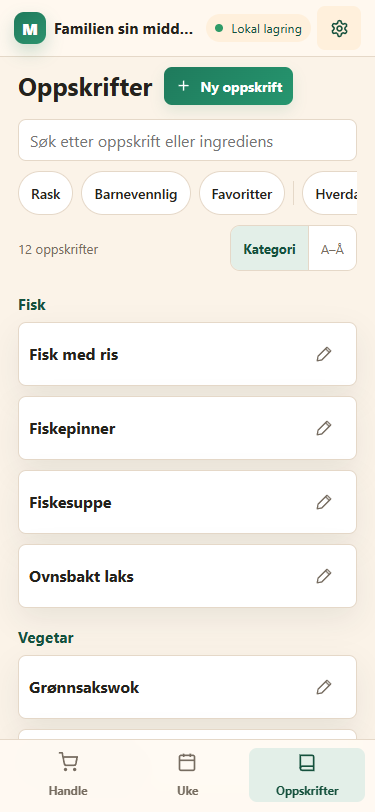
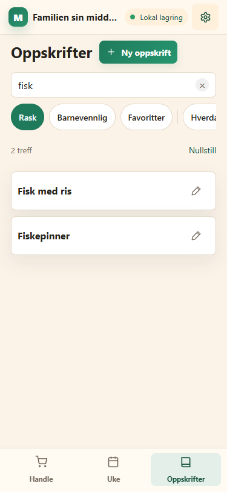
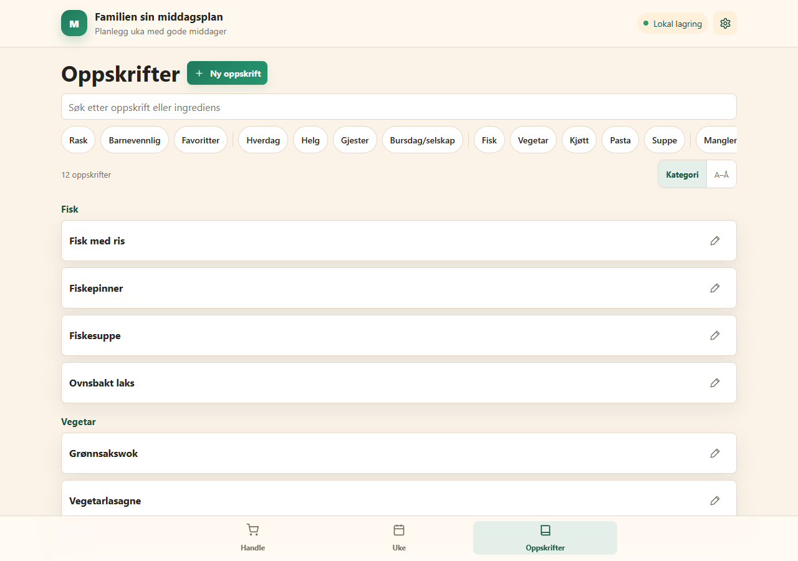
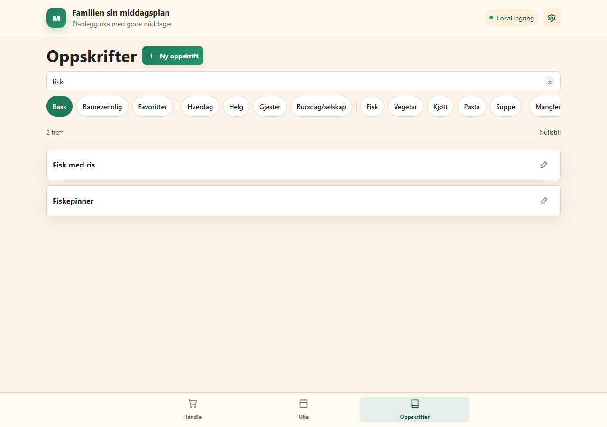

# Leveranse v121 – Søk og filtre i Oppskrifter

Dato: 14. oktober 2026. Utgangspunkt: v120.

## Resultat

Oppskrifter viser treffene én gang, i resultatlisten. Forslagslisten under søkefeltet, renderMealSearchSuggestionsView, Only-varianten, tilhørende binding og CSS er fjernet.

Søkefeltet er type search med enterkeyhint search og samme plassholder. Enter fjerner fokus uten å endre søket. × tømmer bare søket. Skriving tegner bare resultatlisten og trefflinjen på nytt; selve feltet, fokus og markørposisjon beholdes.

Oppskrifter og Velg middag bruker samme renderer og picker-filters-stil med uavhengig tilstand. Flagg kan kombineres, mens bare én dagstype og én kategori kan være valgt. Oppskrifter har i tillegg Mangler oppskrift når relevant, etter eksisterende mealNeedsRecipe-definisjon. Delestreker, aria-pressed, horisontal rulling og fokusbevaring følger velgerens mønster.

Uten søk/brikker vises oppskriftsantallet og Kategori/A–Å. Aktive søk/brikker gir treffantall, Nullstill og flat alfabetisk liste. Tomtilstanden har Ingen oppskrifter passer og Nullstill søk og filtre. Nullstill beholder sorteringen.

Søk/brikker beholdes gjennom økten, åpne oppskrift/tilbake og fanebytte. Bare filters.sort lagres lokalt. Eldre lagrede query/category/flag ignoreres ved oppstart og skrives ikke på nytt. Appen starter fortsatt på Handle, med tomt oppskriftssøk og ingen brikker.

## Endrede og nye filer

| Mappe | Fil | Endring |
|---|---|---|
| Rot | app.js | Felles filterrenderer, egen oppskriftsfiltertilstand, delvis søkeoppdatering, teller/sortering/Nullstill, Enter-blur og tom oppstart. V121/121. |
| Rot | styles.css | Fjernet søkeforslags-/nedtrekksrad-CSS. Trefflinje, sorteringsknapper, tomtilstand og inset for felles brikker i Oppskrifter. |
| Rot | index.html | Alle versjonsparametre til 121. |
| Rot | service-worker.js | Cache v121 og ny filterrenderer i begge asset-listene. Strategien beholdes. |
| Rot | AGENTS.md | Regler for felles filtre, delvis rendering, fokus og lokal lagring av bare sortering. |
| src/render | meal-filters.js | Ny: felles renderer, aktivfiltertest og ren brikkeveksling. Separate scope-/fokus-/rullenøkler. |
| src/render | meals.js | Fjernet søkeforslagsrenderer og nedtrekkslister; felles brikker, treff-/sorteringslinje og tomtilstand. |
| src/domain | suggestions.js | mealMatchesPickerFilters utvidet med needsRecipe. Poengberegningen er uendret. |
| src/sync | local-store.js | Lokal kopi skriver filters:{sort}. Ingen søk, kategori eller brikkeflagg serialiseres. Skysynk er uendret. |
| tests/render | meal-filters.test.mjs | Ny: grupper, rekkefølge, brikkeveksling, kombinasjoner, needsRecipe, teller/sortering/tomtilstand og asset-listene. |
| tests/render | meals.test.mjs | Nye forventninger til søk/brikker, ingen forslagsliste eller gammel renderer. |
| tests/app | meal-filters.test.mjs | Ny: faktiske apphandlinger med DOM-stubb; søk/fokus/markør, Enter, teller, brikker, rulling, navigasjon, lokal kopi og uavhengig velger. |
| tests/app | local-store.test.mjs | Sorteringen beholdes, søk og gamle filtre ignoreres ved oppstart. Full-lagringstestene består fortsatt. |
| tests/app | workflows.test.mjs | needsRecipe-brikke og forventet eksportversjon v121. |
| tests/app | access-startup.test.mjs | Blokkeringsfixture 122, over aktuell versjon. Minimumsforventningen er fortsatt 120. |
| tests/sync | local-store.test.mjs | Bare sortering i lokal filterkopi, uten endring i domenedata. |
| docs | ARCHITECTURE.md | Felles renderer, delvis rendering, fokus/rulling og sorteringslagring. |
| docs | STATE_MODEL.md | Søk/brikker som UI i minnet, bare filters.sort på disk og gamle filtre ignorert. |
| docs | RELEASE.md | Kontrollpunkter etter eiers publisering. |
| docs | LEVERANSE_V121.md | Ny: denne rapporten. |
| docs/screenshots | v121-oppskrifter-375.png | Ny: Oppskrifter uten filter på 375 px. |
| docs/screenshots | v121-oppskrifter-sok-375.png | Ny: søk + Rask på 375 px. |
| docs/screenshots | v121-oppskrifter-1280.png | Ny: Oppskrifter uten filter på 1280 px. |
| docs/screenshots | v121-oppskrifter-sok-1280.png | Ny: søk + Rask på 1280 px. |

Eier tar med **16 endrede og 8 nye filer** i GitHub Desktop. Ingen slettede prosjektfiler. Den nye klientmodulen må følge appen ved publisering. Dokumentasjonsskjermbildene er ikke PWA-assets.

## Testresultat

- Alle **58 testskript** under tests/ og functions/tests/ består uten nettverk.
- **47 kildefiler** består node --check: app.js, service-worker.js, alle src-moduler, functions/index.js og functions/lib. Functions er kontrollert, ikke endret.
- Oppstartstesten kontrollerer også det innebygde HTML-skriptets syntaks. CSS-klammene er balanserte.
- Søk viser treffene én gang, med korrekt teller. Enter blurer; × tømmer bare søket. Felt/fokus/markør beholdes ved delvis rendering.
- Flagg, dagstype og kategori virker samtidig med søk. Ny kategori/dagstype erstatter den forrige, og trykk på aktiv brikke slår den av. Dynamiske dagstypevalg tegnes med samme navn som i Innstillinger.
- Mangler oppskrift tegnes bare når relevant og filtrerer med den eksisterende avledede betingelsen. Ingen lagrede oppskriftsfelt endres.
- Nullstill/tomtilstand tømmer søk og brikker, beholder sorteringen. Søk/filter består gjennom oppskrift/tilbake og fanebytte; gammel lokal kopi gir tom start og beholder gyldig sortering.
- Brikketrykk bevarer fokus, horisontal brikkeposisjon og hovedsidens rulleposisjon. Samme skjermnøkkel brukes som før.
- Eksisterende Velg middag-filtertester består uendret, også forslag, kombinasjoner, nye dagstyper, nullstilling og rulle-/fokusbevaring.
- Appversjon/nummer, HTML-parametre og cache er v121/121. REQUIRED_MIN_APP_VERSION er uendret, 120. Ny renderer er i begge asset-listene.

## Lokale visninger

De faktiske appfunksjonene ble tegnet i lokal Chrome med 12 syntetiske oppskrifter og familienavnet Familien. Firebase-oppstart og service worker ble utelatt i den midlertidige kontrollkopien. Nettverk var blokkert, og **0 HTTP-forespørsler** ble registrert.

Ved 375 × 812 px vises søket, én vannrett brikkerad, antall/sortering og kategorigruppert kortliste. Med søket fisk og Rask aktiv vises 2 treff, Nullstill og to alfabetisk ordnede kort. Ved 1280 × 900 px brukes eksisterende PC-bredde; brikkeraden viser flere valg, men ruller fortsatt som én linje. Ingen visning gir vannrett overløp på siden.

| Nettleserkontroll | 375 px | 1280 px |
|---|---|---|
| Samme søkefelt/fokus/markør etter input | Bestått | Bestått |
| Enter fjerner fokus | Bestått | Bestått |
| Fokus beholdes på Rask etter render | Bestått | Bestått |
| fisk + Rask | 2 treff | 2 treff |
| Vannrett overløp på siden | Nei | Nei |

Midlertidig kontrollskript, HTML/modulkopi og nettleserprofil er slettet. Ekte iPhone/PWA/Safari, skjermtastaturets søketast og touchrulling gjenstår på enhet. Lokal nettleser bekrefter blur-handlingen, men har ikke et skjermtastatur.

## Rammer

Ingen nettverk, installasjon, publisering eller Git-kommandoer. Ingen endring i functions/, firestore.rules, domenemodell, Firestore-struktur eller skysynk. Den eneste endrede filen under src/sync er local-store.js, for den bestilte lokale filterlagringen. Versjonskonstanten for minimum er urørt. Ingen andre mapper enn middagsplanlegger er endret.
