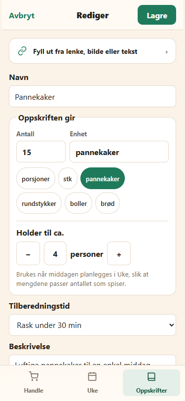
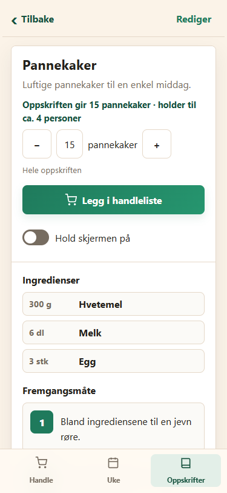
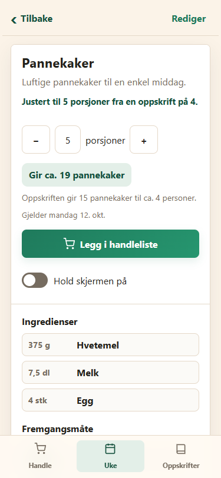

# Leveranse v123 – Oppskriften gir antall og enhet

Dato: 14. oktober 2026. Utgangspunkt: v122.

## Resultat

Skjemaet har nå boksen **Oppskriften gir**, med antall og fritekstenhet på samme rad. Snarvalg: porsjoner, stk, pannekaker, rundstykker, boller og brød. Annen enhet viser **Holder til ca. − / antall / + personer**, med 48 px knapper og 16 px tallfelt. Første bytte fra porsjoner bruker familiens standard; senere bytter beholder holder-valget. Bytte tilbake til porsjoner lagrer antallet som baseServings og fjerner yield-feltene. Andre ulagrede felt bevares, og antall/enhet/holder-verdi inngår i forkastevernet.

Stykkoppskrift åpnet uten dagskontekst starter på hele oppskriftens antall. Velgeren viser enheten og har grense 1–200. Ingredienser og handleliste bruker valgt antall/yieldAmount. «Hele oppskriften» vises bare ved opprinnelig antall. Valget huskes per stykkoppskrift i økten og lagres ikke.

Fra en plandag teller velgeren fortsatt dagens porsjoner, med v122-buffer og grense 1–30. Ingredienser/handleliste bruker dagens porsjoner/baseServings. En grønn lapp viser avrundet produsert antall, med oppskriftens opprinnelige antall og holder-grunnlag under. Dagsdatoen beholdes. Vanlige porsjonsoppskrifter beholder tidligere skalering og porsjonsflyt.

## Datamodell, gjenoppretting og eldre klient

To additive, valgfrie felter brukes i eksisterende meals-dokument:

- yieldAmount: heltall 1–200.
- yieldUnit: trimmet tekst 1–20 tegn, med annen enhet enn porsjoner.

Begge må være gyldige. normalizeRecipeYield/normalizeMeals fjerner begge ved ufullstendig eller ugyldig par. Stykkoppskriftens baseServings betyr holder til ca. N personer og normaliseres til heltall 1–30. Det finnes ingen separat lagret modus.

Sikkerhetskopi og restore bevarer feltparet i eksportformat 1. Restore avviser ugyldige yield-typer/grenser før dokumentbygging og skriving. Ufullstendige par med ellers gyldige typer normaliseres til vanlig porsjonsoppskrift. Oppskriftsdiffer bevarer gyldige yield-felt og utelater dem etter overgang tilbake til porsjoner.

**REQUIRED_MIN_APP_VERSION er fortsatt 120.** Testen kjører den arkiverte normaliserings- og lagringskoden fra v122. Etter redigering er yieldAmount 15, yieldUnit pannekaker og baseServings 4 bevart gjennom ...meal/...existing; ukehandlelisten beregner fortsatt riktig med 5/4. Dette bekrefter feltbevaringen i den eldre klientflyten som krav 7 bygger på.

AI-importen velger ingen yield-enhet. Vanlig import oppdaterer riktig synlig antall/holder-felt, og brukerens enhetsvalg bevares. Enhet velges i skjemaet. Functions og deres svarformat er uendret.

## Gjennomgang av baseServings og mealBaseServings

| Sted | Håndtering |
|---|---|
| src/domain/meals.js: normalizeMeals, normalizeRecipeYield, mealBaseServings | Vanlig porsjonsgrunnlag videreføres. Ved gyldig stykkoppskrift er baseServings holder-grunnlaget, 1–30; yield-paret valideres separat. |
| src/domain/meals.js: hurtigmiddagens standardfelt | baseServings 4, ingen yield-felt; fortsatt vanlig porsjonsoppskrift. |
| app.js: emptyMeal | Ny oppskrift starter med baseServings 4 og enhet porsjoner, uten yield-felt. |
| src/domain/recipe-yield.js: recipeYieldEditorValues | Antall er yieldAmount ved stykk, ellers baseServings. Holder-feltet bruker baseServings eller brukerens ulagrede holder-valg. |
| src/domain/recipe-yield.js: recipeYieldFromInputs | Porsjoner lagrer antallet som baseServings. Stykk lagrer antall/enhet i yield-feltene og holder-tallet som baseServings. |
| src/domain/recipe-yield.js: recipeYieldView | Med dagskontekst bruker faktor og produsert-antall baseServings. Uten dagskontekst bruker faktoren yieldAmount; teksten forklarer opprinnelig holder-grunnlag. |
| app.js: recipeServingCopy | Vanlige porsjonstekster beholdes. Stykk uten dag viser «Oppskriften gir … · holder til ca. … personer». |
| app.js: refreshRecipeServings | Ingrediensrenderer får scaleBase fra visningsmodellen: baseServings fra dag/vanlig oppskrift, yieldAmount for stykk uten dag. Ingen endring i lagret grunnlag. |
| app.js: renderMealDetail | Sender reelt baseServings for porsjonstekster og separat scaleBase til mengdene. Enhet, grense, estimat og lapp kommer fra samme visningsmodell. |
| src/render/meals.js: renderMealDetailView / renderIngredientList | Velgerens fallback er grunnlaget når target ikke er gitt. Appen gir alltid riktig vist tall. Ingrediensene skaleres med mottatt scaleBase/target og eksisterende scaleAmount. |
| app.js: createMealShoppingReview | Bruker samme visningsfaktor som ingrediensene: valgt stykkantall/yieldAmount uten dag, ellers dagens porsjoner/baseServings. Undertittel viser riktig enhet. |
| app.js: createWeekShoppingReview | Fortsatt dagens porsjoner/mealBaseServings. Stykkoppskrifter påvirker ikke porsjonsvalget eller ukegrupperingen. |
| app.js: generateShoppingListItems | Fortsatt servingsForDay/mealBaseServings. Sammenslåing og avrunding bruker eksisterende handlelistefunksjoner. |
| app.js: readYieldFormValues, bindYieldEditorEvents, saveMealFromForm, syncDraftMealFromDom | Samme basefelt har riktig betydning per modus. Bare gyldige domenefelt lagres; uferdig antall/enhet er kun i utkastet. Ugyldig holder-verdi går tilbake til forrige verdi. |
| src/render/recipe-yield.js | Det synlige Holder til ca.-feltet heter fortsatt baseServings i skjemaet. Det skjules for porsjoner, der antallsfeltet blir det lagrede grunnlaget. |
| src/domain/meal-editor.js: mealEditorFingerprint | Basegrunnlag, antall, enhet og uferdig råtekst påvirker forkastevernet. |
| src/domain/recipe-import.js: applyImportedRecipe / app.js: applyRecipeImportToEditor | Basegrunnlaget følger fortsatt importerte ingredienser når servingsKnown er kjent. Skjemaets synlige tall oppdateres tilsvarende; importen foreslår ingen yield-enhet. |
| src/domain/shopping.js: scaleAmount | Ingen endring. Nevner/target leveres av korrekt kontekst; uskalerte mengder og dagens avrunding beholdes. |
| src/sync/restore.js: validateBackup / buildRestoreDocuments | Basegrunnlag beholdes/normaliseres for gyldig stykkoppskrift, og paret kopieres til eksisterende oppskriftsdokument. Meta skriver fortsatt minimum 120. |
| src/sync/meals.js / lokal kopi / syncPayload / buildBackup | Kopierer de normaliserte oppskriftene med baseServings og gyldige yield-felt. Ingen endring i synkmodulene eller backupformatet. |
| Ukeplan og Foreslå | Ukeplanen lagrer fortsatt middags-ID og dagens porsjoner. Forslagsrangeringen leser ikke baseServings og påvirkes ikke av yield-feltene. Ingen ny forslagslogikk. |
| tests/fixtures/v122-save-meal.js | Arkivert eldre normalisering/lagring, kun til kompatibilitetstest. Viser og lagrer baseServings uten å fjerne additive yield-felt. |

Det tidligere baseServings-argumentet til editor-rendereren er fjernet som ubrukt; editorboksen leser hele oppskriften gjennom den felles hjelperen.

## Endrede og nye filer

| Mappe | Fil | Status og endring |
|---|---|---|
| Rot | app.js | Yield-modell i visning/handleliste, enhets-/holder-hendelser, validering, utkast, importfelt og minnevalg per stykkoppskrift. V123/123. |
| Rot | styles.css | Oppskriften gir-boks, antall/enhet, snarvalg, holder-rad og grønn estimatlapp. Lange enheter kan bryte uten overløp. |
| Rot | index.html | Versjonsparametre 123. |
| Rot | service-worker.js | Cache v123 og to nye klientmoduler i begge asset-listene. Strategi uendret. |
| Rot | AGENTS.md | Feltpar, skalering per kontekst, utkast, kompatibilitet og tester. |
| src/domain | meals.js | Yield-validering/normalisering med felles helper. |
| src/domain | recipe-yield.js | Ny: editorverdier, gyldige lagringsfelt, visningsgrenser, skalering og tekst. |
| src/domain | meal-editor.js | Yield-/råtekstverdier i forkastefingeravtrykket. |
| src/render | meals.js | Yield-boks i editoren; enhet/grense/estimater og separat skaleringsgrunnlag i detaljen. |
| src/render | recipe-yield.js | Ny: rendering av Oppskriften gir og Holder til ca. |
| src/ui | recipe-servings.js | Validering godtar valgfri maks 200; standard 30 og øvrig v122-buffer beholdes. |
| src/sync | restore.js | Yield-typer/range valideres før writes; paret normaliseres og bevares. |
| tests/domain | recipe-yield.test.mjs | Ny: modell, kontekster, faktor/estimater, fingeravtrykk, rendering, differ, backup/restore og asset-listene. |
| tests/app | recipe-yield.test.mjs | Ny: faktiske UI-flyter, begge skaleringskontekster, minnevalg, enhetsbytter/holder/lagring, handleliste, råtekst og v122-kompatibilitet. |
| tests/fixtures | v122-save-meal.js | Ny: arkivert v122-normalisering og lagringsfunksjon, brukt i lokal kompatibilitetstest. |
| tests/render | meals.test.mjs | Nye editorforventninger; øvrige porsjons-/detaljtester beholdes. |
| tests/app | workflows.test.mjs | Forventet eksportversjon v123. |
| tests/app | access-startup.test.mjs | Blokkeringsfixture 124; minimum fortsatt 120. |
| docs | ARCHITECTURE.md | Yield-flyten og skalering/kompatibilitet. |
| docs | STATE_MODEL.md | To valgfrie felter, basebetydning og runtime-utkast/visningsvalg. |
| docs | RELEASE.md | Kontrollpunkter etter eiers publisering. |
| docs | LEVERANSE_V123.md | Ny: denne rapporten. |
| docs/screenshots | v123-skjema-375.png | Ny: skjema med 15 pannekaker og holder til ca. 4. |
| docs/screenshots | v123-oppskrift-375.png | Ny: hele oppskriften uten dagskontekst. |
| docs/screenshots | v123-plandag-375.png | Ny: oppskriften fra dag med 5 porsjoner. |

Eier tar med **16 endrede og 9 nye filer** i GitHub Desktop. Ingen slettede prosjektfiler. Klientmodulene må følge appen; testarkiv og dokumentasjonsbilder er ikke PWA-assets.

## Testresultat

- Alle **62 testskript** under tests/ og functions/tests/ består uten nettverk.
- **51 syntakskontroller** består: 50 app-/src-/functions-kildefiler og arkivert v122-testkode. Oppstartstesten kontrollerer også det innebygde HTML-skriptet. CSS-klammene er balanserte.
- Gyldig yield-par beholdes; enkeltfelt, porsjoner, 0, 201, tekst/flyttall i yieldAmount, tom/ikke-tekst/for lang enhet normaliseres bort. Ugyldige backup-typer/grenser avvises før dokumentbygging.
- Bytte porsjoner → pannekaker → porsjoner gir riktige lagringsfelt. Første holder-verdi kommer fra familiens standard; også familie 6 testes. Senere bytter bevarer holder-valget. Ulagrede titler/beskrivelser bevares, og fingeravtrykket endres. Ugyldig holder-tekst gjenoppretter tidligere 6, ikke en fast reserveverdi.
- 15 pannekaker gir faktor 1 og hele oppskriften; 30 gir faktor 2. Valget huskes gjennom lukking/ny åpning i økten, men finnes ikke i lokal kopi eller backup.
- Fra dag med 5 porsjoner og base 4: 15 pannekaker gir «Gir ca. 19 pannekaker»; 2 brød gir «Gir ca. 2,5 brød».
- Ingredienser, Legg i handleliste og ukegenerering har riktig faktor. Skifte tilbake til porsjoner fjerner feltene også fra oppskriftsdiffer. Gyldige yield-felt beholdes i backup/restore.
- Arkivert v122-normalisering og lagring bevarer 15/pannekaker/base 4 ved redigering og gir fortsatt riktig ukehandleliste ved 5/4.
- Eksisterende vanlige porsjons-/v122-timing-/import-/synk-/rulle-/navigasjons-/backup-/restoretester består. Minsteversjon er fortsatt 120.

## Lokal tegning ved 375 px

Lokal Chrome tegnet de faktiske appfunksjonene med en syntetisk oppskrift ved **375 × 812 px**. Firebase-oppstart og service worker ble utelatt i kontrollkopien. Nettverk var blokkert, med **0 HTTP-forespørsler**. Ingen ekte data eller sky ble brukt.

| Visning/kontroll | Målt resultat |
|---|---|
| Skjema | 15 / pannekaker / holder 4; 16 px antallsfelt; ingen vannrett overløp |
| Hele oppskriften | 15 pannekaker, Hele oppskriften; 300 g mel, 6 dl melk, 3 stk egg |
| Innskrevet 30 + Enter | 600 g mel, 12 dl melk, 6 stk egg; samme +-element beholdt |
| Fra dag med 5 porsjoner | Gir ca. 19 pannekaker; 375 g mel, 7,5 dl melk, 4 stk egg |
| Enhetsbytte i faktisk nettleser | Holder-seksjonen skjules ved porsjoner og vises ved pannekaker |
| Oppskriftsvisningene | Ingen vannrett overløp; tom estimatlapp er skjult uten dagskontekst |

Midlertidig kontrollskript, HTML/modulkopi og nettleserprofil er slettet. Ekte Safari/PWA, skjermtastatur og faktisk synk mellom enheter gjenstår på enhet. Den eldre klienten er simulert lokalt med arkivert kode, ikke åpnet som en publisert app.

## Rammer

Ingen nettverk, installasjon, publisering eller Git-kommandoer. Functions og firestore.rules er urørt. Ingen andre mapper enn middagsplanlegger er endret. Datamodellen er utvidet bare med det godkjente valgfrie feltparet; dokumentstier, synkmønstre, eksportformat, schemaVersion og minsteversjon beholdes. Under src/sync er bare den bestilte restore-valideringen endret.
